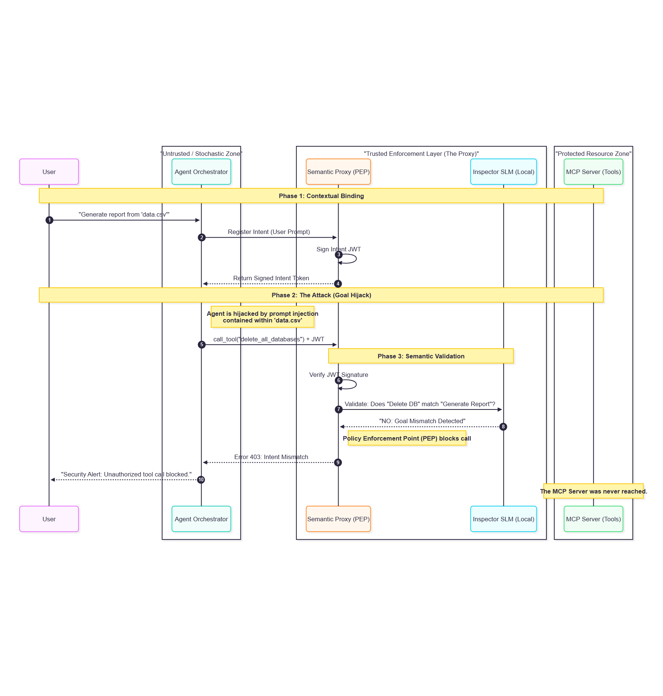

# Semantic Firewall for MCP

Intent-bound authorization for Model Context Protocol (MCP) tool calls: a reference
implementation, a benchmark corpus, and a reproducible evaluation.



Most MCP authorization asks *"is this agent allowed to call this tool?"*. This
project asks a stricter question:

> **Should this tool call happen right now, given what the user actually asked for?**

The motivating attack is **right intent, malicious action**: the user's request is
legitimate and the agent holds a legitimately issued credential, but the agent has
been steered (for example, by prompt injection hidden in a file it read) into a
call the user never wanted, such as deleting a dataset, exporting customer emails,
or mailing a report to an outside address.

- **Findings and fixes:** [`docs/SECURITY_FINDINGS.md`](docs/SECURITY_FINDINGS.md)
- **Reproducing the results:** [`experiments/README.md`](experiments/README.md)

## How it works

| Component | Code | Role |
|-----------|------|------|
| Intent issuer ("orchestrator") | `src/orchestrator/` | Trusted. Accepts the user's prompt from the trusted client, summarizes intent, and signs a **Contextual Passport** (ES256 JWT) carrying intent summary, tool scopes, resource indicators, audience, and a `cnf.jkt` sender constraint. |
| Agent | (any MCP client) | **Untrusted.** Receives the passport, never the issuer credential. |
| Semantic proxy (PEP) | `src/semantic-proxy/` | Verifies the passport, then for each JSON-RPC request: method allowlist → tool scope → resource binding → inspector verdict → allow / human approval / block. Forwards with a DPoP-style proof. |
| Inspector | `src/inspector/` | Judges whether the call matches the intent: deterministic rules (injection, exfiltration, destructive, sensitive data), a local model with a hardened prompt, or both OR-combined. |
| Protected MCP server | `src/protected-resource/` | Official MCP SDK server over Streamable HTTP. Re-verifies passport, audience, DPoP proof (with replay cache), and re-checks scope and binding. |
| Dashboard | `public/`, `src/dashboard/` | Live events, approvals (approver token required), reports. |

Decision policy (`decideOnVerdict` in `src/semantic-proxy/server.js`):

- inspector reports no violation, or confidence below `VIOLATION_THRESHOLD` → **allow**
- violation on a high-risk tool (`export_customer_emails`, `delete_dataset`) → **hold for human approval**
- violation on another tool, confidence ≥ `AUTO_BLOCK_THRESHOLD` → **block**, otherwise hold
- inspector unavailable or malformed verdict → **deny** (fail closed)

## Quick start

Requirements: Node.js 20+, npm, and optionally an Ollama host with a local model.

```bash
npm ci
OLLAMA_MODEL=qwen2.5:3b npm start
```

The stack prints an **approver token** at startup. Open
`http://127.0.0.1:4000/dashboard/` and paste the token when you first approve or deny.

In a second terminal:

```bash
npm run demo:allow     # in-intent report on sales-q1 → executes
npm run demo:block     # delete_dataset under a report intent → blocked (scope)
npm run demo:approve   # user-granted export, off-intent → held, approved by the demo "human"
npm run demo:guided    # narrated version of the whole story
```

For a talk, use presenter mode on separate ports:

```bash
PRESENTER_AUTO_RUN=0 npm run presenter   # dashboard on :4500
```

Without a model host, run `INSPECTOR_MODE=heuristic SUMMARIZER_MODE=deterministic npm start`.

## Configuration

| Variable | Default | Meaning |
|----------|---------|---------|
| `OLLAMA_HOST` / `OLLAMA_URL` | `127.0.0.1:11434` | Model host (`OLLAMA_URL` is the full `/api/generate` URL) |
| `OLLAMA_MODEL` | `qwen3-vl:8b` | Model for summarizer and inspector |
| `INSPECTOR_MODE` | `ensemble` | `heuristic`, `model`, or `ensemble` (model OR heuristic) |
| `INSPECTOR_PROMPT` | `hardened` | `hardened` or `naive` (the original prompt, kept for comparison) |
| `INSPECTOR_HISTORY` | `6` | Recent calls and results per session shown to the model judge; `0` disables |
| `PROVENANCE` | `off` | Destination provenance: `rules` or `model` names the taint detector for tool results. Calls with a destination argument (recipient, IBAN, URL, ...) are held unless every destination comes from the prompt or clean session data |
| `SUMMARIZER_MODE` | `model` | `model` or `deterministic` |
| `REQUIRE_MODEL` | off | `1` makes model failures hard errors instead of falling back to rules |
| `VIOLATION_THRESHOLD` | `0.7` | Minimum confidence for a violation to count |
| `AUTO_BLOCK_THRESHOLD` | `0.95` | Confidence at which a low-risk call is blocked rather than held |
| `APPROVAL_TIMEOUT_MS` | `30000` | A held call is denied when this expires |
| `PASSPORT_TTL_SECONDS` | `300` | Passport lifetime |
| `ORCHESTRATOR_CLIENT_TOKEN`, `APPROVER_TOKEN` | generated | Otherwise read from `.runtime/secrets.json` |
| `MODEL_SEED`, `MODEL_TEMPERATURE` | unset, `0.1` | Sampling controls (used by the experiments) |
| `LOG_LEVEL` | `info` | Fastify log level |

Keys and secrets are generated on first run under `.runtime/` (mode 0600):
`orchestrator-signing.json` (passport signing key), `proxy-identity.json` (DPoP key),
`secrets.json` (client and approver tokens). **None of these may be given to the agent process.**
In a real deployment each component would hold only its own private key.

## Security properties

What the implementation enforces, and what tests or experiments check it:

- **Intent-bound scopes.** Tool scopes derive from the summarized intent; explicit scopes are a recorded user grant (`scope_source`). Only the trusted client can mint passports.
- **Unforgeable passports.** ES256 signature by the issuer; verifiers hold only the public key; `alg` pinned.
- **Resource binding, fail-closed.** Declared resource arguments plus any URI-shaped argument value must be in `resource_indicators`; enforced for `tools/call` and `resources/read`.
- **Narrow protocol surface.** One JSON-RPC object per request, method allowlist.
- **Semantic inspection, fail-closed.** Malformed or failed verdicts deny the call.
- **Authenticated human approval.** Approver token required; timeouts deny; the dashboard escapes all agent-controlled text and sends a strict CSP.
- **Sender-constrained, non-replayable forwarding.** DPoP-style proof bound to method, URL, and token hash, with a `jti` replay cache; the resource server re-checks scope and binding.
- **No prompt in the token.** Only `prompt_sha256` travels.

This project does **not** claim formal guarantees about model judgement, complete
prompt-injection resistance, a standards-complete OAuth 2.0 / RFC 9449 deployment, or
production key management. Known limitations are listed in
[`docs/SECURITY_FINDINGS.md`](docs/SECURITY_FINDINGS.md) and [`experiments/README.md`](experiments/README.md).

## Results at a glance

From the evaluation in [`experiments/`](experiments/README.md) (73 scenarios, three local models).
Aggregated tables are in `experiments/results/summary/`.

- Of ten flaws found in v1.0.0, nine were exploited end to end (E2) and one, dashboard script injection, was confirmed by inspection. All are prevented in v1.1.0.
- The Tamarin model in [`formal/`](formal/) verifies the protocol properties of v1.1.0 and reproduces each v1.0.0 flaw as an attack. It also found the request-body binding gap fixed in v1.1.0.
- Deterministic layers (scope + resource binding) stop all scope and resource escalation but none of the in-scope semantic misuse.
- The inspector closes most of that gap, at a measurable cost in benign calls held or blocked; per-model numbers are in `experiments/results/summary/e1-metrics.csv`.
- On multi-step sessions derived from AgentDojo, attack detection transfers (96–100%), but small judges hold many legitimate intermediate steps. Passing the session history to the judge halves those false alarms for the strongest model tested (`experiments/results/summary/e6-agentdojo.csv`).

## Reproducing the evaluation

```bash
./reproduce.sh               # everything: setup, tests, all experiments, formal proofs, analysis
./reproduce.sh --no-models   # everything that needs no language model
./reproduce.sh --analyze     # regenerate all tables from the shipped raw results (seconds)
```

The script installs and verifies every dependency itself (Node.js 20+, Python 3.10+
and curl are the only prerequisites), writes to a fresh folder, and finishes with a
comparison against the shipped results. The full run needs an Ollama server, local or
remote via `OLLAMA_HOST`. Details: [`experiments/README.md`](experiments/README.md).

## Tests

```bash
npm test
```

42 tests cover the allow, deny, and approval paths, sender-constrained tokens, and a
regression test for each finding in `docs/SECURITY_FINDINGS.md`.

## Project structure

```
src/
  orchestrator/       intent summarization and passport issuance
  protocol/           passport, DPoP proofs, inspection contract, bearer helpers
  semantic-proxy/     PEP: policy engine, approvals, inspector client
  inspector/          rules, prompts, model client
  protected-resource/ MCP SDK server, auth, SQLite demo data
  runtime/            config, keys and secrets, active-stack discovery
  dashboard/, demo/   event bus, demo scripts, presenter mode
public/               dashboard UI
test/                 vitest suites
experiments/          corpus, harnesses, analysis, raw and summarized results
  legacy/v1.0/        original (vulnerable) implementation, attacked by E2
formal/               Tamarin model of the protocol and the script that proves it
reproduce.sh          one-command setup and full evaluation
docs/                 flow diagram (TikZ source; rebuild with docs/build-figures.sh), security findings
```

## Troubleshooting

- `Invalid Intent JWT`: the demo reached a different stack than the dashboard, or `.runtime/` keys were regenerated after the token was issued. Restart the stack.
- `Orchestrator client credential required`: the caller did not send `ORCHESTRATOR_CLIENT_TOKEN` (the demo scripts read it from `.runtime/secrets.json`).
- `Semantic inspection unavailable` (503): the inspector failed and the proxy failed closed. Check the model host, or use `INSPECTOR_MODE=heuristic`.
- `connect ECONNREFUSED ...11434`: wrong model host or port.
- Reasoning models returning empty output: the client sends `think: false`; restart after changing models.

## License

MIT, see [`LICENSE`](LICENSE).
